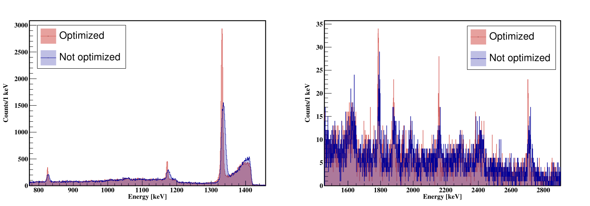

# AgataSelector
[](https://doi.org/10.5281/zenodo.8329198)


This analysis code is meant for the data of AGATA+$Ancillary, producing various histograms and performing kinematic calculations and other operations useful for Doppler correction and other analysis tasks.
The starting point of the selector are the ROOT files produced by femul.
The code is a work in progress and is meant to be updated and modified by both users and the local group. 
We log the bug fixes, improvements and broken compatibility issues  in the ```CHANGELOG.md``` file.
It is based on ROOT and requires an installed version where ROOT has been compiled with at least c++ 14.
Our intent is to make the analysis procedure straightforward and reproducible. 
Every output file will contain a configuration folder that contains the configuration file of the selector used to perform the calculations, the lookup tables, the date and the git hash.
This means that at any time the outcome of the analysis is reproducible. 

Additional materials on the selector are in the [Documentation](Documentation) folder. The documentation includes detailed slides of the latest Agata Analysis Workshop and will guide the user trough the analysis steps.

## Contents

1. [Installation procedure](#installation-procedure)
2. [Run the selector](#run-the-selector-on-the-data)
3. [Performing the analysis](#performing-the-analysis)
4. [Selector options](#selector-options)
5. [Prisma](#prisma)
6. [Notes on user selectors](#notes-on-user-selectors)
7. [Advanced options](#advanced-options)
8. [Optimizers](#optimizers)
    * [Selector's builtin optimization](#selectors-builtin-optimization)
    * [Scan of the LUT parameters](#scan-of-the-lut-parameters)
    * [Grid search of the LUT parameters](#grid-search-optimizator-for-silicon-detectors)

## Installation procedure

- [x] Clone the repository
- [x] Create a build folder
- [x] Configure with cmake
- [x] Compile

```
git clone https://baltig.infn.it/gamma/agataselector.git
cd agataselector
mkdir build; cd build
cmake ..
make -j4
```

If you want to perform a personalized analysis for your experiment, before compiling with make, specify the proper experiment name.
For instance for EXP_001 you would specify:

```
cmake -DEXP_NAME=EXP_001 .
```

In this case the code will look for a folder called ```EXP_001``` under ```User/EXP/```.
Inside the folder it will expect a new selector with your additions. You should copy the template found in the Template folder.
Add histograms to the struct defined in the ```.h``` file. If the experiment is not there, a new one with the required name will be created.

In the root files you can write the TTree for a given detector. On top of that, every file contains the configuration used to analyze it.
However, ROOT needs the dictionaries to support all the functionalities of the classes serialized in the file. To support this feature you can add the following code to the ```~/.bashrc```. You need to call it from the build directory:

```
source Scripts/selector.sh
```

This also adds the bash completition and the possibility to use some things like the ```Fitter``` class interactively.

If you want to be extra careful and check if your installation is done correctly you can perform a test. To do so, compile with the correct flag and run the following commands:

```
 cmake -B build -DENABLE_TESTING=ON -S .
 cmake --build build -j6
 cd build/Tests
 ctest --output-on-failure -j6
```

## Run the selector on the data

- [x] Configure the configuration file to your liking
- [x] Run the selector
- [x] Find your data in the output folder
- [x] At the end of the data processing you should find a file containing the total sum of all the run files

The basic way to launch the analysis is the following:

```
./RunSelector #runnumber
```

Checkout ```./RunSelector -h``` for more options.

## Performing the analysis

First of all, checkout the README.md files that you can find in the **Conf** folders.
The folder User is meant to contain the analysis personalized for the user's experiment. 
In particular, it works as a selector. The user should add the histograms of interest to the selector in the usual way. 
The "standard" selector with the histograms of general interest are always produced if it is so specified in the configuration file.

Important notes: check that the lookup table of your detector is present in ```Conf/LUT/```, that the directory specified in the configuration file is there and that the Conf folder and ```selector.conf``` are present in the directory where you lunch the selector.

## Prisma

The selector can now run the full analysis of prisma. This allows to run the optimizer on the optical parameters of the spectrometer. Please refer to this [PRISMA_README.md](PRISMA_README.md) for more information. The documentation is still preliminary and is not complete.

## Selector options

This is a list with a brief description of the various command-line options:

| Option                | expected input        | Description                                                                                                                                                                                                                                                                                                                                                                                                                                                                                     |
|-----------------------|-----------------------|-------------------------------------------------------------------------------------------------------------------------------------------------------------------------------------------------------------------------------------------------------------------------------------------------------------------------------------------------------------------------------------------------------------------------------------------------------------------------------------------------|
| --help                | -                     | Prints a help menu                                                                                                                                                                                                                                                                                                                                                                                                                                                                              |
| --nrevts              | [#]                   | Specify number of events to analyze, default is all.                                                                                                                                                                                                                                                                                                                                                                                                                                            |
| --nrthr               | [#]                   | Specify maximum number of threads, default is 6. Note that if the selector is killed by the OS, it might mean that there is not enough memory and you might have to reduce the number of threads of disable some of the produced histograms if possible.                                                                                                                                                                                                                                        |
| --conf                | [file]                | Specify a conf file, default is in ```../Conf/```.                                                                                                                                                                                                                                                                                                                                                                                                                                              |
| --iofile              | [infile, outfile]     | Specify an input and an output file, this will disregard the conf.                                                                                                                                                                                                                                                                                                                                                                                                                              |
| --iolistfile          | [file]                | Specify a file where to read a list of inputFile outputFile line by line.                                                                                                                                                                                                                                                                                                                                                                                                                       |
| --verb                | [#]                   | Verbosity: 0 (prints progress Sel), 1 (prints debugging info).                                                                                                                                                                                                                                                                                                                                                                                                                                  |
| --no_user_sel         | -                     | Runs standard selector without the analysis contained in ```User/UserSelector.cxx```.                                                                                                                                                                                                                                                                                                                                                                                                           |
| --print_conf          | [out_file]            | Prints the default conf file with default values for each parameters. Note that some of the options might not be present, an example is ```EX_VALUES``` of AGATASPIDER_CONF.                                                                                                                                                                                                                                                                                                                    |
| --rm_partial          | -                     | Removes partial output files that correspond to each file in the input folder.                                                                                                                                                                                                                                                                                                                                                                                                                  |
| --optimize            | -                     | Runs optimizer on the given peak by running the selector multiple times.                                                                                                                                                                                                                                                                                                                                                                                                                        |
| --only_enabled_histos | -                     | Creates and fills only the histograms present in the file ```${CONF_FOLDER}/enabled_histos.conf```                                                                                                                                                                                                                                                                                                                                                                                              |
| --debug_canvas        | -                     | Shows a canvas at each fit (at the moment it is used only in the optimization procedure)                                                                                                                                                                                                                                                                                                                                                                                                        |
| --reduction_cond      | [reduction condition] | Creates a new reduced data TTree based on the given reduction condition. Bash special characters should be escaped with the backslash character. For instance to set a condition on Z in PRISMA and the number of tracked gammas to reduce the input file, one would add   ``` ./RunSelector --reduction_cond nbTrack\>0\&\&Z_Nr\>0 262```. In this case in the data folder of run 262 one would find new reduced ROOT files with the prefix ```red_```the condition ```"nbTrack>0&&Z_Nr>0"```. |
| --set_gates           | [selector file]       | Starts the automatic procedure to set the gates on. The gates are then read automatically. Create with the toolbar a TCutG and close it with a double-click. The terminal will then ask you to input the id of the cut.                                                                                                                                                                                                                                                                                                                                                                                                                                                          |
| --no_hadd             | -                     | Does not hadd to sum up the statistics                                                                                                                                                                                                                                                                                                                                                                                                                                                          |
| --update_runs         | -                     | Run the selector only for trees not present in the output folder procedure)                                                                                                                                                                                                                                                                                                                                                                                                                     |
| --update_prisma       | -                     | Updates the prisma part of the analysis                                                                                                                                                                                                                                                                                                                                                                                                                                                         |
| --sum_all             | -                     | Runs hadd of all runs processed in the current session, the file will be called runs-#-#-#.root                                                                                                                                                                                                                                                                                                                                                                                                 |
| --subtract_bkg        | -                     | Subtracts the background based on the left and right windows set up in the configuration file.                                                                                                                                                                                                                                                                                                                                                                                                  |
| --window_size         | -                     | Size of the progress window. If not present it is calculated automatically                                                                                                                                                                                                                                                                                                                                                                                                                      |

Entries in `enabled_histos.conf` are matched as exact histogram names by default. To use a
regular expression, append `#regex` to the end of the line. Regular expressions match the whole
histogram name, for example:

```
h_CR
^h_E_ion.*$ #regex
```

If you create a file:

```touch StopFile```

The analysis will finish and root files will be closed with the collected statistics.

## Notes on user selectors

In case of personalized selector, you should have compiled the selector with the option ```-DEXP_NAME=YOUR_EXP_NAME``` as explained in the previous section.
If you want to personalize a part of the analysis or add histograms, you can do so by modifying the template user selector. 
Additionally, it is possible to read fom the ```selector.conf``` file some user-defined parameters that can be helpful for your analysis.
Please refer to old experiments as the way to implement these customizations.

## Advanced options

### Running Docker

If you have compatibility issues such as compilation errors, problems with root and so on, there might be an *easy* fix.
You can try to run docker which should take care of all of that. First of all install docker and start the demon ```sudo service docker start```.
From the root of this repository run

```
docker build -t fedora-agata .
```

This will create a virtual (fedora) machine with the correct dependencies. This will take some time and takes up some space. It is slow only the first time you build it as it has to build root and install the dependencies.
Once the execution has finished, you can run the selector on the virtual machine with very little overhead. Navigate to your analysis folder and launch the command like so:

```
 docker run -v "$(pwd)":/home/seluser/host fedora-agata "RunSelector --window_size 150 1"
```

The command will make it so that the current directory, that should be your analysis directory will be seen by the docker image. Note that the command to run the selector must be enclosed in quotes and the window_size is specified to print correctly the progress bars. You should be able to run all the selector comands in this way.
If you want to open a shell in the virtual machine

```
docker run -it fedora-agata sh 
```

Note that in the docker image, also `femul` is instlled, so in the same way you can run femul in your replay folder like so:

```
 docker run -v "$(pwd)":/home/seluser/host fedora-agata "femul -k"
```

If you want the docker to forward X on mac, go on xquartz->settings->security->allow connections from network clients. Then add the localhost to the clients that can forward trough network `xhost +localhost`, then run the docker like so:

```
 docker run -it -e DISPLAY=docker.for.mac.host.internal:0 fedora-agata sh
```


### Distributing on multiple machines

To distribute the jobs on multiple machines it is possible to use MPI. To do so `boost-mpi` needs to be installed on the nodes. Then you should launch the following cmake command in the build folder:

```
 cmake -DCMAKE_CXX_COMPILER=mpic++ -DUSE_MPI=On .
```

Then you should create a file called `hfile` containing the ip addresses of the machines. Then simply run `./RunSelector --distribute [..oher options..]`

### Additional Scripts

You can also compile the additional scripts in the Scripts folder by adding a cmake option. One example is the script to read the raw data of the digitizers and build ancillaty events. 

```
 cmake -DBUILD_SCRIPTS=On .
 make
```


## Optimizers

There are several ways to optimize the outcome of the data with the selector.
Here we report a brief description of each.

### Selector's builtin optimization



The ```--optimize``` option runs the selector multiple times trying to minimize a figure of merit which is a combination of the centroid min and the sigma of the peak.
The bias on the two conditions can be set in the selector configuration file with ```SIGMA_WEIGHT```. 
The fitter class can fit at the same time multiple peaks and combine them in the figure of merit. 
The parameters to be optimized are those included in the configuration file such as ```Z_SHIFT```,  ```PHI```, ... 
In practice, any parameter that is a floating point number can be optimized.
Different minimizer algorithms can be tried by choosing them in the configuration file. The outcome is a matter of trial and error. 
It is advised to run the optimization procedure on data which has been reduced with the ```--reduction_cond option``` to speed up the procedure.
For instance, if one wants to optimize the coincidence spectrum between agata and prisma, it will be faster to select only good coincidence events between prisma and agata.
This can be done by setting the condition on ```nbTrack>0``` and ```A_Nr==32``` (for instance) and so on.  

Use ```--debug_canvas``` to check the quality of the fit at the first steps.

Check the progress of the minimizer during each step in the file ```./Conf/Optimizer/log.txt``` or whatever specified in the selector configuration file.

The parameters of the fit, if the default ones are not ok can be set in the file called ```./Conf/Optimizer/parameters.dat``` or the name indicated with the keyword ```FIT_PAR_FILE```.
This file will be created with the default parameters if nothing is found in the right folder. Be careful, if the file is there the parameters will be read from it. 
This means that when the fit does not make sense it is probably because the parameters are not ok, so you can just delete the file so that it is generated automatically.

The optimization procedure is not limited to the impovement of the Doppler correction but can also be applied for the improvement of Q-value or excitation energy distributions.

Parameters part of the user configuration are also accessible. Generally, one should try to optimize multiple transition at once to obtain the most stable results.

The range of variation of the parameters should be gradually reduced as one converges to a solution. To do so, it is often useful to plot the gradient of a parameter. 
This is done with the  ```SCAN``` parameter in the configuration file. This will vary the specified parameter with the selected step and ultimately produce a root file (specified as ```ROOT_FILE```) with as many ```TGraph```s as the number of scanned parameters.
The ```SCAN``` option will also add a ```TH2D``` histgram with the parameter on the x-axis (in internal units) and the spectrum on the y-axis. This allows to inspect the effect of the parameter on the whole spectrum.
It is also possible to create a contour plot (with the keyword ```CONTOUR```) to check the correlation of different minimized parameters. This, however, requires a lot of iterations and does not often converge to something that makes sense.

### Scan of the LUT parameters

The previous selector can only optimize parameters in the ```selector.conf``` file. 
However, other important parameters are contained on some detector's lookup tables. 
If this is the case there are two options, the grid search optimizer (see next section [Grid-search optimizer](#grid-search-optimizator-for-silicon-detectors)) or the ```LUT_OPTIMIZER```.
The latter is a workaround that uses a special type of user selector to perform a scan of the LUT parameters.
In this case one can scan parameters independently, but the algorithm is very general and can be used on many detectors.
Please find a step-by-step guide in the [User/EXP/LUT_OPTIMIZER](/User/EXP/LUT_OPTIMIZER/README.md).

###  Grid-search optimizator for silicon detectors

This program will perform a grid search of the optimal parameters in the lookup table of the detectors allowing for the fine-tuning.

#### Requirements
This application requires a compiler that supports `C++17` or newer, with ROOT compiled against this version. The project must be compiled with the `GRID_OPTIMIZER` flag:

```bash
cmake -DGRID_OPTIMIZER=ON -DCMAKE_BUILD_TYPE=Release [path_to_selector_core_CMakeFile]
make -j [number of threads for compilation]
```

and to run
```bash
./RunGridOptimizer  --verb 2 --conf [path to selector.conf] --nrthr [nthreads for selector] [#run1 run2 ...] 
```
#### Overview

The purpose of this application is to determine the effective position of different strips/pads of silicon detectors. This is achieved by adjusting the position of the detector's strips/pads to observe changes in a user-selected quantity sensitive to the detector position - such as doppler-broadened gamma peak(s), excitation energies, etc. The objective function used for minimization can be configured via the selector's configuration file. The application operates in several quasi-independent stages, described below. Note, that the resolution gains depends on the specifics of your experiment. 


<blockquote style="border-left: 4px solid orange; padding-left: 1em;">
<div style="color: orange; font-weight: bold;"> Warning</div> This implementation of the grid minimizer acts as a user selector to access selector configuration. If you require use of your own selector you can replace the UserSelector code in the <code style="background-color: #d0d0d0">User/grid_optimizer/Conf_and_DummySelector</code> folder, but only append to the existing UserConf class. 
</blockquote>


##### Preprocessing
During this stage, the `selector.conf` file is read, and several selector settings are statically enforced (these are listed in the output). Offset pairs are generated in either Cartesian [x,y,z] or spherical [theta,phi] coordinates as per the specification in configuration file. An optimizer object is initialized for each enabled detector. The `DATA_REDUCTION_CONDITION` is utilized to generate new files, which are subsequently used as input for the selector. If a reduced file already exists, it is skipped. To enhance efficiency, reduced files are merged, typically into a single file per run (optimization is pending).

<blockquote style="border-left: 4px solid blue; padding-left: 1em;">
<div style="color: blue; font-weight: bold;"> Note</div> 
Files produced by selector will contain numberical hash value calculated from the <code style="background-color: #d0d0d0">DATA_REDUCTION_CONDITION</code> so uniquly identify files produced by given condition. String of the reduction condition cannot be used in the file name due to expected presence of forbidden characters (such as & | etc.).
</blockquote>

<blockquote style="border-left: 4px solid blue; padding-left: 1em;">
<div style="color: blue; font-weight: bold;"> Note</div> 
It is strongly recommended to use a very specific and refined <code style="background-color: #d0d0d0">DATA_REDUCTION_CONDITION</code> to speed up next stage. Style of the condition is same as for <code style="background-color: #d0d0d0">TTree::Draw()</code> function.
</blockquote>

<blockquote style="border-left: 4px solid blue; padding-left: 1em;">
<div style="color: blue; font-weight: bold;"> Note</div> 
Keep in mind that the condition are set <b>BEFORE</b> selector, so e.g. doppler corrections are not yet applied and events of interest might be scattered.
</blockquote>


##### Selector Loop
In this stage, the positions in the look-up table for each segment, strip, pixel, etc., are adjusted by a defined offset. Subsequently, the selector is executed. This process is repeated for each offset. If an output root file for a given offset already exists, the selector is not run. The output file will only contain the histograms/matrices specified in `ENABLED_HISTOS` and `MATRIX_NAME`.
##### ROOT file processing
A list of **ALL** existing selector-prodced root files present in current directory is constructed - not just ones produced in the previous stage, but also ones produced during previous runs. From each file a matrix with `MATRIX_NAME` is extracted and used for fitting. A Y-projections are contructed for each bin, empty ones are ignored. Each projection is fitted.

<blockquote style="border-left: 4px solid purple; padding-left: 1em;">
<div style="color: purple; font-weight: bold;"> Important</div> It is required that the matrix has unique segment names on X axis and energy/spectrum the Y axis. Label of the Y axis should also contain unit for proper unit conversion; e.g. <i>Something something label [keV]</i>.
</blockquote>

Fit is performed in `FIT_RANGE_START - FIT_RANGE_END` range. Peak position is estimated by identifying bin with maximum number of counts. Currently 2 peak functions are available for `PEAK_FIT_FUNCTION` option: 
- **Lorenzian** 
$$f(x) = \frac{V}{\pi} \cdot \ \cdot \frac{\frac{\Gamma}{2}}{(x - \mu)^2 + \frac{\Gamma^2}{4}} + p_0 + p_1 x$$
- **Skewed Gaussian**
$$f(x) = \frac{V}{\sigma \sqrt{2\pi}} e^{-\frac{1}{2} \left(\frac{x - \mu}{\sigma}\right)^2} \cdot \left(1 + \textit{erf}(\alpha \cdot \frac{x - \mu}{\sqrt{2}\sigma})\right) + p_0 + p_1 x$$


The objective function can be constructed by using the `FIT_WEIGHT_*` parameters for fitted width, volume and position offset (calculated as a difference between fit mean and `FIT_PEAK_ENERGY`). There are also 2 additional parameters which meaning can change with different fit models:
- **Lorenzian** does not use any
- **Skewed Gaussian** uses `PAR_3` for skew parameter $\alpha$

The `WIDTH` parameter can be customized to hold different value then the $\sigma$ of given fit-function model. Using the `PEAK_FIT_WIDTH_STRATEGY` the width parameter in the objective function can contain:
- Full Width at x-th fraction of the Maximum (FWxM)
- Full width at a given static function value

The value of "x-th maximum" or "static function-value" can be setup using `PEAK_FIT_WIDTH_STRATEGY_VALUE`.

Each fitted histogram together with the fit results is saved into a ROOT file `optiprocessed_[DETECTOR_NAME]_[HASH].root`. Fit results are stored as a custom objects in a tree.

##### Optimize and compare
In the last stage acquired points are ploted in a 2D graph and fitted with a 2D polynomial

$$f(x, y) = p_0 + p_1 x + p_2 y + p_3 x^2 + p_4 y^2$$

Inevitably, some fits performed in previous stage will be marked as invalid by the ROOT's minimizer. Therefore, two 2D graphs with different validity status ("only_valid_fits" and one with "allow_invalid_fits") are constructed and fitted separately. The 2D graphs for all detectors are converted into histograms and saved in a root files `optimization_graph_fits_[DETECTOR_NAME]_[VALIDITY_STATUS].root`. 

The minimum of the 2D polynomial is then applied as an optimal position of a given detector's segment. A new look-up table is constructed and stored in the same directory as the original with `_optimized` suffix. Selector is run again with optimal positions and file `opti_compare.root` stores the original spectra (<span style="color:blue;">&#9679;</span>) and optimized ones: only_good_fits (<span style="color:black;">&#9679;</span>) and allow_invalid_fits (<span style="color:red;">&#9679;</span>).

<blockquote style="border-left: 4px solid purple; padding-left: 1em;">
<div style="color: purple; font-weight: bold;"> Important</div> Minimum of the 2D polynomial must be found within the borders of the 2D graph; e.i. within the offset limits set in configuration file. Extrapolation is forbidden.
</blockquote>

#### All configuration options for `selector.conf`

Example of all options available for grid-search optimizer.

```
GRID_SEARCH_OPTIMIZATION 

RUN_PREPROCESSING             YES
RUN_SELECTOR_LOOP             YES
RUN_ROOT_FILE_PROCESSING      YES

MATRIX_NAME                m_SpiderID_EDC
ENABLED_HISTOS             m_SpiderID_EDC m_SpiderID_EDCBP # matrices/histograms you want selector to produce, others are disabled
REDUCED_FILE_PATH          /home/mbalogh/angcal/agataselector/build # Path to store reduced input files

# setup offset points used for minimization
# spherical coordinates - for annular detectors, such as SPIDER, SAURON
THETA_OFFSET_RANGE_START    -10	deg # lower range to vary theta, in deg
THETA_OFFSET_RANGE_END      10  deg # upper range to vary theta, in deg
THETA_STEP                  10  deg # size of a theta step in deg, if defined range contain zero, the steps are always counted from 0 (included) until limit is reached
PHI_OFFSET_RANGE_START      -10  deg # lower range to vary phi, in deg
PHI_OFFSET_RANGE_END        10  deg # upper range to vary phi, in deg
PHI_STEP                    10  deg # size of a phi step in deg, if defined range contain zero, the steps are always counted from 0 (included) until limit is reached
#custom [theta,phi] points, combinations are not computed
THETA_CUSTOM_OFFSET         0  1  1 -1 -1   # in deg  
PHI_CUSTOM_OFFSET           0 -1  1  1  1   # in deg

# carthesian coordinates
X_OFFSET_RANGE_START  -10  mm #  
X_OFFSET_RANGE_END     10  mm #  
X_STEP                 0.1 mm #
Y_OFFSET_RANGE_START  -10  mm #
Y_OFFSET_RANGE_END     10  mm #
Y_STEP                 0.1 mm #
Z_OFFSET_RANGE_START  -10  mm #
Z_OFFSET_RANGE_END     10  mm #
Z_STEP                 0.1 mm #
# custom [x,y,z] points, their combinations are not computed
X_CUSTOM_OFFSET 1 2 3 4 5 # in mm
Y_CUSTOM_OFFSET 1 2 3 4 5 # in mm
Z_CUSTOM_OFFSET 1 2 3 4 5 # in mm

# Fit parameters
FIT_PEAK_ENERGY               1332.514 keV
FIT_RANGE_START               1250.000 keV
FIT_RANGE_END                 1400.000 keV
PEAK_FIT_FUNCTION             Lorenzian # #1: SkewedGaussian #2: Lorenzian
# weights used to calculate the numerical value that is to be minimized  
FIT_WEIGHT_WIDTH              1.
FIT_WEIGHT_POSITION           0. # the position part is calculated as abs(FIT_PEAK_ENERGY-fit_centroid)
FIT_WEIGHT_VOLUME             0. 
FIT_WEIGHT_PAR3               0 # defined for skewed gaussian as the exponential parameter (should be 0 for ideal gaussian)
FIT_WEIGHT_PAR4               0 # not used for anything at the moment
#customizing what does the "width" parameter contain 
PEAK_FIT_WIDTH_STRATEGY       FWxM # Options: #1: STATIC_VALUE-calculate width at given Y value 
                                              #2: FWxM-calculate Full Width at x-th maxium (FWHM x=2, FWTM x=10, ...)
PEAK_FIT_WIDTH_STRATEGY_VALUE 4 # #1: STATIC_VALUE -> this is y value of the histogram, 
                                  #2: FWxM -> this is the "x" value e.i. FWTM: x=10 etc
```
