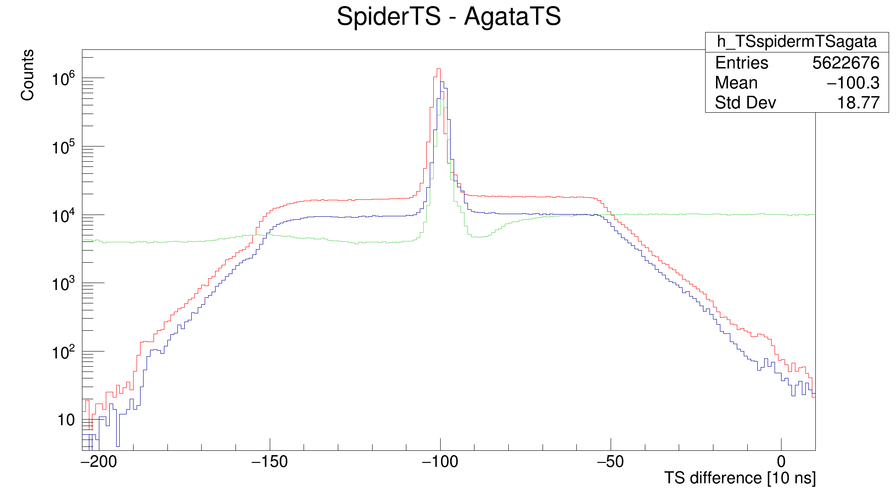

# The time coincidence problem

## Identifying the issue

If the time difference ```ancillary-agata``` is empty in the range -100 -> 100, or if it looks like the green line in this picture, there is something wrong. It should have a clear window plus exponential tails like the other historams in the picture.



The problem is caused by an offset on the ancillary data with respect to AGATA. We need to apply an offset (to be foubd) to be able to merge events correctly.

## Instructions on how to fix it

Fist of all, compile the script with 

```
sh compile.sh
```

You should get an executable called ```fix``` to find the offset. This correlates all possible events and generates a histogram where a peak should be present. 
The x-position of the peak corresponds to the peak value.


### Finding the offset

You should have the agapro package installed with the ```ListFrames``` program installed. Locate your ancillary BU file whith should be named like ```ancillaryBU_i***_****_0000.adf```. Chose one good AGATA crystal and locate the ```psa_0000.adf``` file under the data folder such as ```Data/00A/psa_0000.adf```. 
 
Modify the script ```generate.sh``` to point to those files and run it with ```sh generate.sh```. Two files called ```anc.txt``` and ```agata.txt``` should be generated. 

Now it's the time to run ```./fix``` which will read these two files and generate a root file called ```out.root```. Inside this file there should be a big histogram, locate the peak in the histogram and note precisely the x-axis position. This is your offest number. You may have to modify the fix.C script to change the limits and binning of the histogram of the dimension of the vectors in case no peak is present. Then recompile the script.

You can use the macro ```drawHist.cxx``` for help in finding the peak.

### Applying the offset

Now that you have an offset, use the ```ReadCaenRaw``` as you normally would but with the option ```--global-anc-tsoffset value```, where value is the position of the peak. 

### Replaying the new data

Replay the data using this file as the ancillary file.

Create a directory with the run number: ```mkdir run_**** && cd run_****```.

The first setep consists in linking the data. Locate the raw Agata data folder and link it as:

```
ln -s /path/to/data/run_0000_ddmmyy_*/Data
```

Move the fixed ```spider_0000.adf``` file in the replay folder. 
Copy the following files and folders to the folder: ```gen_conf.py Conf Topology***```.

Run the ```gen_conf.py``` script:

```./gen_conf.py```

Run femul as:

```femul Topology*** | tee log.txt```

This will create a ```log.txt``` file which you can inspect.

You should find the results in ```./Out/Analysis/Tree_****.root```.
 
